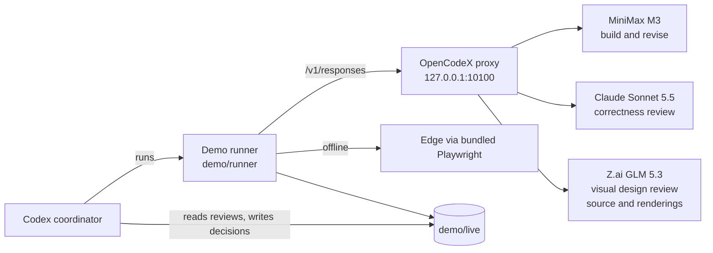

# Architecture

The demo shows one Codex session coordinating three models from three providers. Codex stays in charge of the task and the decisions; the outside models each do one focused job and return their output as data.

## Components

| Component | Role |
|---|---|
| Codex coordinator | The model running the Codex session. It starts each runner stage, reads the draft and reviews, and decides which findings to apply. The live demo and the backup run used GPT-6.1 Sol, but it can be any model that Codex can select, such as Claude Opus through OpenCodeX. |
| OpenCodeX | A local proxy that receives OpenAI-style requests and forwards each one to the provider for the requested model ID, using that provider's subscription or API key. |
| Demo runner | `demo/runner/run.mjs`, started through `demo.ps1`. It sends the model requests, validates replies, runs the browser checks, and writes all run files. |
| MiniMax M3 | Builds the calculator from a short brief, then implements the coordinator's accepted changes. Low reasoning effort. |
| Claude Sonnet 5.5 | Reviews the draft's logic, validation, and rounding. High reasoning effort. |
| Z.ai GLM 5.3 | Proposes up to three concrete visual changes, using the backup's design as the reference. High reasoning effort. It reviews the source and two Edge renderings of the draft (1280px and 390px), and never sees the revised app. |
| Edge | Checks each version of the app offline: totals, auto-update, Reset, input validation, a 390px layout, and zero network requests. |

## Data flow and scope

Each model gets only what its job needs. MiniMax receives the calculator brief; for the revision it also gets its draft, the accepted findings, and the draft check result. The reviewers receive their instructions and the draft source. Skipped findings, chat history, the backup, and other repository files are never sent. Every model reply is treated as data, and the runner rejects replies that request tools or add network access to the app.

The routed workers are direct requests through the proxy. They don't appear as native Codex subagents in the app, and each has its own context.

## Safety boundaries

- A demo run replaces only an allowlisted set of generated files in `demo/live/`. It never touches `demo/backup/`, source fixtures, or the slides.
- A revised app becomes `index.html` only after it passes the offline browser check.
- Sharing the repository, changing providers or credentials, deleting files outside the allowlist, and pushing require separate approval. See [AGENTS.md](../AGENTS.md).
